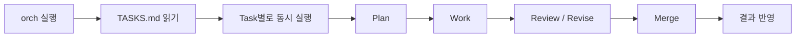

# LpOrch

`TASKS.md`에 작업을 한 줄씩 적어두면, `.orch` 오케스트레이터가 이를 읽어 여러 AI 에이전트(Claude Code 또는 Gemini CLI, 역할별 선택)를 병렬로 실행하고 **Plan → Work → Review → Merge** 과정을 거쳐 문서·코드·시스템 변경 결과물을 만들어내는 자동화 시스템임.



## 핵심 특징

- **병렬 실행** — `TASKS.md`의 각 줄이 독립된 Task가 되어 동시에 처리됨 (`after:`로 지정한 선행 Task가 있으면 대기). 동시 실행 개수는 CPU/메모리 기준으로 자동 결정됨
- **교차 리뷰** — 작업을 수행한 에이전트와는 다른 새 에이전트가 리뷰를 담당해 CRITICAL/WARNING을 판정하고, 필요한 수정은 원 작업자가 이어서(resume) 반영함
- **3가지 작업 종류** — `doc`(문서), `code`(격리된 git worktree 코드 변경), `sys`(오케스트레이터 자신의 변경, 샌드박스 사본 + 자동 체크 통과 시에만 반영)
- **대규모 작업 분할** — `mode: full` 지정 시 Planner가 작업을 1~4개 Part로 나눠 동시 처리 후 Ring Review와 Merge를 거침
- **안전장치** — 위험 Bash 명령 차단 훅(`protect-files.sh`), `.env`/secret 파일 수정 차단, destructive git 명령 deny 목록 등을 기본 내장

## 요구사항

- Python 3.11+
- 사용하는 provider의 CLI (역할 하나라도 그 provider를 쓰는 경우에만 필요)
  - claude: [Claude Code](https://docs.claude.com/claude-code) CLI (native 설치 또는 npm 설치) + `claude-agent-sdk` — 로그인된 계정/API 키 필요
  - gemini: [Gemini CLI](https://github.com/google-gemini/gemini-cli) — 아래 "Gemini provider" 참조
- Node.js + npx — `.mcp.json`에 등록된 MCP 서버(`context7`, `sequential-thinking`, `notion` 등) 실행용
- `code` 작업을 쓸 경우 프로젝트가 git 저장소여야 함

## 설치

```bash
pip install -r .orch/requirements.txt
```

`claude-agent-sdk`만 설치하면 됨(claude provider용). Claude Code CLI는 별도로 로그인되어 있어야 함. SDK는 claude 역할이 처음 실행될 때 import되므로, gemini만 쓰거나 `orch preview`만 실행할 때는 없어도 동작함.

## 빠른 시작

1. `TASKS.md`에 작업 줄 추가

   ```
   - [ ] [doc] API 변경 영향 분석 보고서
   ```

2. 실제 실행 없이 계획만 확인

   ```
   orch preview        # PowerShell: .\orch preview
   ```

3. 실행

   ```
   orch                # PowerShell: .\orch
   ```

   Claude Code 안에서는 `/orch`, `/orch preview`로도 실행 가능함.

4. 결과 확인 — `doc/[Txx]_<날짜>_<제목>.md`, `git diff --cached`(code), `report/[Txx]_<날짜>_<제목>.md`(code·doc Task별 진행 보고), `.orch/runs/<run-id>/summary.md`

## 설정 (orch.toml)

프로젝트 루트의 `orch.toml`에서 실행 옵션 기본값과 역할별 provider/model을 지정함. 우선순위는 **CLI 옵션 > `orch.toml` > 내장 기본값**이며, 파일이나 키가 없으면 내장 기본값을 사용함. 알 수 없는 섹션·키, 잘못된 타입·범위는 실행 전에 `error: orch.toml: ...`로 중단됨.

| 섹션 | 키 | 기본값 | CLI 옵션 | 의미 |
|---|---|---|---|---|
| `[run]` | `max_parallel` | `0` | `--max-parallel` | 전체 동시 에이전트 수, `0` = 자동(CPU·메모리·작업 수 기준) |
| | `max_rounds` | `1` | `--max-rounds` | 리뷰/수정 라운드, `0` = 리뷰 없음 |
| | `budget_per_agent` | `2.0` | `--budget-per-agent` | 에이전트 호출당 USD 상한 |
| | `max_turns` | `40` | `--max-turns` | 에이전트 호출당 turn 상한 |
| `[agent]` | `provider` | `"claude"` | `--provider` | 역할별 지정이 없는 모든 역할의 provider (`claude` \| `gemini`) |
| `[claude]` | `model` | `""` | `--model` | 주 모델, `""` = CLI 기본 모델 |
| | `small_model` | `"haiku"` | — | namer·reporter용 모델, `""` = `model`과 동일 |
| | `cli_path` | `""` | `--cli-path` | native claude 실행 파일, `""` = 자동 탐지 |
| | `max_retries` | (CLI 기본 10) | — | API 요청 실패(429·529·네트워크) 재시도 횟수. 지정 시 `CLAUDE_CODE_MAX_RETRIES`로 전달 |
| `[gemini]` | `model` / `small_model` | `""` / `"flash-lite"` | `--model` | `[claude]`와 동일한 의미 (`""` = CLI 기본 `auto`) |
| | `cli_path` | `""` | `--cli-path` | gemini 실행 파일 또는 `gemini.js`, `""` = 자동 탐지 |
| | `max_retries` | `0` | — | API 요청 실패(429 quota·네트워크) 재시도 횟수(0~9). `0` = 즉시 실패 (CLI 기본은 요청당 10회) |
| `[roles.<역할>]` | `provider`, `model` | — | — | 역할별 override |

- 역할: `doc-worker`, `code-worker`, `sys-worker`, `reviewer`, `doc-merger`, `code-merger`, `planner`, `namer`, `reporter`
- 역할의 model 결정 순서: `[roles.<역할>] model` → (namer·reporter만) provider의 `small_model` → provider의 `model` → CLI 기본 모델
- `--model`·`--cli-path`는 기본 provider(`--provider` 또는 `[agent] provider`)의 `model`·`cli_path`만 바꾸며, `[roles.*]` override와 다른 provider 설정은 그대로 유지됨
- `orch preview`에 적용된 설정 파일과 역할별 provider/model이 표시됨

```toml
# 예: 작업은 Claude, 리뷰는 Gemini로 교차 검증
[roles.reviewer]
provider = "gemini"
model = "pro"
```

### Provider 구조

claude와 gemini는 같은 interface를 가진 backend로 대칭 구성됨.

- **공통 호출**: 모든 phase는 `agents/runner.py`의 `RunAgent`만 호출함. `RunAgent`는 역할의 provider를 골라 그 backend의 `Run(label, prompt, spec, ctx, model) -> AgentResult`를 실행함
- **backend**: `agents/claude.py`(claude_agent_sdk), `agents/gemini.py`(Gemini CLI headless). 처음 호출될 때 import되므로 쓰지 않는 provider의 SDK·CLI는 필요 없음
- **공통 규격**: 역할별 도구(`ROLE_TOOLS`, Claude Code 도구 이름 기준), structured output용 JSON schema(`AgentSpec.schema`), tool 진행 로그 형식은 `runner.py`에서 정의하고, 각 backend가 자기 방식으로 변환함
- **등록**: `core/providers.py`에 provider별 기본값(`small_model`, `max_retries`), `max_retries` 상한, preview 안내문, backend 모듈을 등록함. `orch.toml`의 `[<provider>]` 섹션 검증·기본값은 여기서 자동으로 따라옴
- provider 추가 = `core/providers.py` 항목 1개 + `agents/<provider>.py` backend 1개

### Gemini provider

`provider = "gemini"`인 역할은 Gemini CLI를 headless(`stream-json`)로 실행함 (`.orch/agents/gemini.py`). ring review(`mode: full`)에서 리뷰어와 작업자의 provider가 다르면 세션을 이어받을 수 없어 fresh reviewer로 대체됨.

- **준비**: Gemini CLI 설치 후 인증. API key(OS keychain에 저장된 key 또는 `GEMINI_API_KEY` 환경변수)나 Vertex 환경변수 방식 권장
- **실행 격리**: 실행마다 `.orch/runs/<run-id>/gemini/home`을 `GEMINI_CLI_HOME`으로 사용함
  - 사용자의 `~/.gemini/settings.json`을 복사한 뒤 CLAUDE.md context, `max_turns`, guard hook을 덮어씀
  - 세션도 이 폴더에 저장되며 사용자의 `~/.gemini`는 건드리지 않음
  - `~/.gemini`의 파일에만 있는 인증(OAuth 로그인 캐시, `~/.gemini/.env`의 key)은 이 폴더에서 보이지 않음
- **도구 제한**: Claude 역할별 도구를 Gemini built-in으로 변환한 policy(`--policy`)를 적용함. 나머지 도구와 MCP는 전부 차단됨
- **보안장치**: `write_file`/`replace`/`run_shell_command` 호출 전에 `.orch/agents/gemini_guard.py`가 실행됨
  - 프로젝트 `.claude/settings.json`의 `permissions.deny` 규칙과 PreToolUse hook(`protect-files.sh` 등)을 그대로 적용함
  - 검사 자체를 할 수 없으면 차단함(fail closed)
- **역할 프롬프트**: system prompt에 덧붙일 수 없어 세션 첫 메시지 앞에 넣음
- **structured output**: reviewer, planner, namer의 JSON 응답은 프롬프트로 요청하고 파싱함. 실패하면 같은 세션에서 1회 재요청함
- **API 실패**: Gemini CLI는 기본적으로 요청 하나를 최대 10회 재시도함. 분당 한도 초과(429)는 약 1분 간격으로 재시도해 수십 분씩 멈춘 것처럼 보일 수 있음
  - LpOrch는 `[gemini] max_retries`(기본 `0`)로 이를 제한함
  - 실패한 시도와 quota 내역(`Quota exceeded for metric: ...`)은 콘솔에 WARNING으로 표시됨
  - 무료 tier key는 모델별 분당 요청 한도가 낮음(예: 5회). 에이전트 하나가 도구를 몇 번만 써도 한도에 닿으므로 결제가 연결된 key 권장
- **제약**:
  - 비용(USD)이 보고되지 않음 → summary에는 `$0`으로 집계되고, 호출별 token 수와 실제 사용 model은 `run.log`에 기록됨
  - `budget_per_agent`는 적용되지 않음. `max_turns`만 적용됨
  - headless에서는 build 파일(`CMakeLists.txt`, `*.cmake`, `package.json`, `pyproject.toml` 등) 수정이 Gemini CLI 자체 정책으로 차단됨 → build 설정을 바꾸는 code 작업은 Claude 권장
  - Windows에서 Gemini의 shell은 PowerShell임. deny 규칙은 명령 문자열로 비교하므로 bash 기준 규칙이 PowerShell 명령(`Remove-Item` 등)까지 막지는 않음

## TASKS.md 작성법

### 기본 형식

```
- [ ] [<kind>] <title>
- [ ] [<kind>:<role>] <title>
```

- `<kind>` : `doc` / `code` / `sys` 중 하나
- `<role>` : (선택) `.claude/skills/develop/<role>.md` 스킬 추가 주입 (예: `code:refactorer`, `doc:researcher`)
- 상태 마커: `[ ]` 대기, `[~]` 실행 중, `[x]` 완료, `[!]` 실패 — `[!]`/`[x]`를 `[ ]`로 되돌리면 재시도됨
- 구분 공백과 checkbox는 생략 가능하고 대소문자는 무시됨: `-[doc]제목`, `- [][Doc] 제목`, `- [ ] [doc] 제목`은 모두 같은 대기 작업. 실행되는 작업 줄은 표준 형식(`- [~] [doc] 제목`)으로 다시 쓰임
- 작업처럼 보이지만 인식되지 않는 줄(`- [ ] [docs] x`, `* [ ] [doc] x`, 제목 없는 `- [ ] [doc]` 등)은 `orch preview`·`orch` 실행 시 `warning: TASKS.md line N is not read as a task ...`로 표시됨. 실행은 계속됨

| kind | 설명 | 결과물 위치 |
|---|---|---|
| `doc` | 리서치/작성/분석 → Markdown 산출물 | `doc/[Txx]_<YYMMDD>_<제목>.md` |
| `code` | 격리된 git worktree에서의 코드 변경 | 워킹 트리에 staged 상태로 반영 (`git diff --cached`) |
| `sys` | 오케스트레이터 자신(`.orch/`, `.claude/`, `CLAUDE.md`, `TASKS.md`, `orch.toml`, `orch*.bat`)의 변경 | 자동 체크·리뷰 통과 시 실제 파일에 적용, 원본은 `.orch/runs/<run-id>/<Txx>/backup/`에 백업 |

### 상세 지시(directive)

작업 줄 아래 2칸 이상 들여쓴 줄은 작업 지시문이며, 아래 키워드로 시작하면 설정으로 해석됨.

```
- [ ] [doc] 예시 작업 제목
  일반 설명 텍스트는 그대로 작업 지시문으로 전달됨
  after: T04, T05
  ref: doc/refs/spec.md
  lang: en
  verify: pytest -q
  mode: full
```

| directive | 의미 |
|---|---|
| `after: Txx, Tyy` | 지정한 작업들이 끝날 때까지 대기 후 그 결과를 입력으로 사용 |
| `ref: <path\|URL>` | 작업의 근거 자료(파일/폴더/glob/URL). 작은 텍스트 파일은 프롬프트에 직접 삽입되고 리뷰어가 대조 검증함 |
| `lang: en` | doc 산출물 출력 언어 지정 (기본값: 한국어) |
| `verify: <command>` | code/sys 작업에서 반드시 통과해야 하는 쉘 커맨드 |
| `mode: full` | 대규모 작업을 1~4개 에이전트로 분할하는 멀티 에이전트 파이프라인 사용 (기본값: standard, 1에이전트+1리뷰) |
| `→ result: <location>` | 작업 성공 시 오케스트레이터가 자동 기록. 사람이 직접 쓸 필요 없음 |

## 실행 모드

- **standard (기본값)** — worker 1명 작업 → reviewer 1명 리뷰 → 동의하는 CRITICAL/WARNING만 수정 (WARNING만 있으면 재검증 생략, 토큰 절약)
- **mode: full** — Planner가 1~4개 Part로 분할 → Part별 동시 작업 → Ring Review(서로 돌림 리뷰) → 필요 시 재검증 → Merger가 통합 → 통합 결과 재리뷰 (standard 대비 토큰 약 4~5배 소모)

## 결과물 확인

- `doc` → `doc/[Txx]_<YYMMDD>_<제목>.md` (1작업당 1문서). 문서에는 본문만 들어가고, 작성자의 가정 사항·병합 메모·미해결 리뷰 지적은 진행 보고로 감
- `code` → 워킹 트리에 staged 변경 (`git diff --cached`로 리뷰)
- `sys` → 시스템 파일에 직접 적용, 원본 백업은 `.orch/runs/<run-id>/<Txx>/backup/`, 전체 diff는 `sys.diff`
- 진행 보고 → 실행된 code·doc Task마다 `report/[Txx]_<YYMMDD>_<제목>.md` 생성 (sys Task는 생성 안 함). run 종료 시 `small_model`(기본 haiku)이 run 기록(`run.log`, `notes`/`review`/`response`/`checks`, 변경 파일 또는 문서 목차)을 읽고 개요·진행 경과·작업 내용·가정 사항·리뷰 지적사항 및 처리 결과·후속 조치를 한국어로 정리함 (요약 실패 시 원자료를 그대로 기록, `after:` 선행 실패로 blocked된 Task는 제외)
- 로그/리뷰/요약 → `.orch/runs/<run-id>/summary.md`에서 작업별 상태·파트 수·리뷰 결과·비용 확인 가능

## 디렉터리 구조

```
.
├── orch.bat              # orch 실행 런처 (PowerShell: .\orch)
├── orch-reset.bat         # doc/*.md, report/*.md, 런 로그, TASKS.md 작업 목록 초기화
├── TASKS.md               # 작업 목록 (사람이 직접 작성)
├── orch.toml              # 실행 옵션 기본값, 역할별 provider/model
├── CLAUDE.md              # Claude Code 전역 규칙
├── doc/                   # doc 작업 결과물
├── report/                # code·doc Task별 진행 보고
├── .orch/                 # 오케스트레이터 본체 (Python, 패키지는 위쪽 패키지만 import함)
│   ├── orchestrate.py     # 진입점 (orch run / preview)
│   ├── reset.py           # 진입점 (orch-reset)
│   ├── core/              # SDK-free 기반
│   │   ├── paths.py       # 프로젝트 경로, 산출물 파일명(doc/·report/)
│   │   ├── providers.py   # provider registry (기본값, retry 상한, preview 안내, backend 모듈)
│   │   ├── config.py      # orch.toml 로드·검증, 역할별 provider/model 결정
│   │   ├── runcontext.py  # run 전체가 공유하는 상태 (RunContext)
│   │   ├── tasks.py / taskfile.py  # Task/Part 모델, TASKS.md 파싱·기록
│   │   ├── context.py     # ref 자료, 선행 결과, 프롬프트 context
│   │   └── capacity.py    # 자동 병렬 수 결정
│   ├── workspace/
│   │   ├── gitops.py      # code 작업용 git worktree 관리
│   │   └── sandbox.py     # sys 작업용 샌드박스, 자동 체크
│   ├── agents/
│   │   ├── runner.py      # provider 중립 에이전트 호출 (AgentSpec, AgentResult, RunAgent)
│   │   ├── claude.py      # Claude backend (claude_agent_sdk)
│   │   ├── gemini.py      # Gemini backend (Gemini CLI headless)
│   │   └── gemini_guard.py  # Gemini 쓰기·shell 호출에 .claude 보안 규칙 적용하는 hook
│   ├── reporting/
│   │   ├── report.py      # 리뷰 상태·gating, summary.md, 선행 Task 리뷰 이력
│   │   └── progress.py    # Task별 한국어 진행 보고 생성
│   ├── pipeline/
│   │   ├── taskflow.py    # Task 1개의 전체 흐름 (upstream 대기 → plan → work → review → merge)
│   │   ├── planning.py    # mode: full Part 분할
│   │   ├── phases.py      # workspace 준비, 작업, 수정, 자동 체크
│   │   ├── review.py      # ring review, verify, 통합 리뷰
│   │   └── merge.py       # Part 병합, 결과 반영 (doc 작성, code staging, sys 적용)
│   ├── prompts/           # 역할별(worker/reviewer/merger/namer/reporter) 프롬프트
│   └── runs/              # 실행별 로그/리뷰/요약 (git에는 미포함)
└── .claude/
    ├── settings.json      # 권한(allow/deny), 안전 훅 설정
    ├── hooks/              # 위험 명령·sensitive 파일 차단 훅
    └── skills/
        ├── common/        # 모든 작업에 공통 적용되는 가이드라인
        └── develop/        # 역할별 스킬 (refactorer, reviewer, tester 등)
```